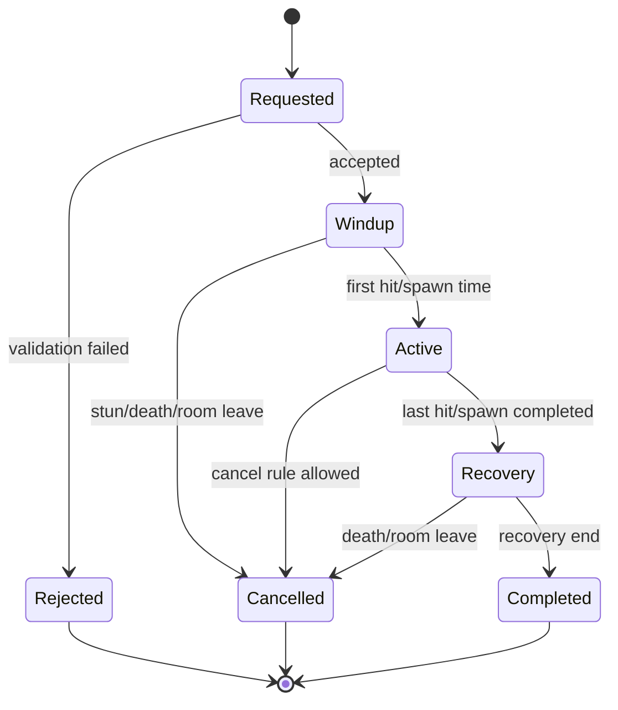

# 서버 권위 원칙과 Combat ID 계약

## 1. 문서 상태

- 단계: Phase 0 — 계약과 진단 기반
- 상태: 설계 확정안
- 범위: 서버 권위, Ability/Effect/Action 식별자, 요청 검증, Action/Effect 생명주기, 전투 패킷 초안
- 구현: 이 문서에서는 진행하지 않음

이 문서는 이후 전사 기본 공격 수직 슬라이스의 서버·클라이언트 공통 계약이다.

## 2. 핵심 결정 요약

1. IOCP GameServer가 모든 전투 결과의 유일한 권위자다.
2. 클라이언트는 행동의 의도만 보내며 Damage, Heal, Cost, Cooldown 결과를 보내지 않는다.
3. `AbilityId`와 `EffectId`는 빌드 간 유지되는 정적 데이터 ID다.
4. `ActionInstanceId`와 `ActiveEffectInstanceId`는 서버가 생성하는 일시적 런타임 ID다.
5. `ClientActionSequence`는 클라이언트 요청의 중복 방지와 예측 결과 매칭에만 사용한다.
6. 서버 판정 시각은 서버의 monotonic tick이며 클라이언트 시각과 AnimNotify는 판정 근거가 아니다.
7. UE GAS는 서버 상태의 표현·예측 계층이며 권위 상태 저장소가 아니다.

## 3. 용어와 ID 구분

| 이름 | 크기 | 생성 주체 | 수명 | 의미 |
|---|---:|---|---|---|
| `AbilityId` | uint32 | 정적 데이터 | 영구 | 어떤 스킬 규칙인가 |
| `EffectId` | uint32 | 정적 데이터 | 영구 | 어떤 버프·디버프·즉시 효과 규칙인가 |
| `ObjectId` | uint64 | 서버 | 서버 객체 수명 | 어떤 Player·Monster·Projectile인가 |
| `ActionInstanceId` | uint64 | Room 서버 | Action 수명 | 이번 한 번의 스킬 실행은 무엇인가 |
| `ActiveEffectInstanceId` | uint64 | Room 서버 | Effect 적용 수명 | 대상에게 적용된 이번 Effect는 무엇인가 |
| `ClientActionSequence` | uint32 | 클라이언트 | Session 수명 | 어떤 입력 요청에 대한 응답인가 |
| `RoomEventSequence` | uint32 | Room 서버 | Room 수명 | Room 이벤트 순서와 Snapshot 기준점 |
| `HitIndex` | uint32 | 서버 Action | Action 수명 | 다단 Hit 중 몇 번째 판정인가 |

### 3.1 금지하는 혼용

- `AbilityId`를 `ActionInstanceId`로 사용하지 않는다.
- `EffectId`를 활성 버프 한 건의 제거 키로 사용하지 않는다.
- `ClientActionSequence`를 서버 Action ID로 신뢰하지 않는다.
- `ObjectId`를 DB의 `CharacterId`로 사용하지 않는다.
- Gameplay Tag 문자열을 네트워크 권위 ID로 직접 사용하지 않는다.

## 4. 서버 권위 원칙

### 4.1 신뢰 경계

서버가 클라이언트로부터 신뢰하는 것은 다음 두 가지뿐이다.

- 인증된 TCP Session에서 패킷이 도착했다는 사실
- 사용자가 특정 Ability를 사용하려는 의도를 보냈다는 사실

패킷에 포함된 나머지 값은 모두 검증 대상이다.

### 4.2 서버가 Session에서 강제 결정하는 값

- Source Player와 Source ObjectId
- 현재 Room
- PlayerClass와 Granted Ability 목록
- 현재 HP/MP와 상태
- 서버 Position과 Rotation
- Cooldown과 ActiveEffect

`C_USE_SKILL`에는 `actor_id`를 넣지 않는다. 필요한 경우 디버그 필드가 있더라도 서버는 무시하고 `session->player`를 사용한다.

### 4.3 클라이언트가 보낼 수 있는 의도 값

- `ability_id`
- `client_action_sequence`
- 선택적 `target_object_id`
- 선택적 `aim_position`
- 선택적 `aim_direction` 또는 `aim_yaw`

Target과 Aim은 요청일 뿐이며 최종 Target, 시작 위치, 판정 방향은 서버가 검증·보정한다.

### 4.4 절대 클라이언트가 보내지 않는 값

- Damage와 Critical 결과
- Heal 양
- MP Cost와 Cooldown 시간
- Buff 수치와 Duration
- Hit 여부와 Hit Target 목록
- Projectile ObjectId
- Action 시작 시각과 Hit 시각의 최종값
- Reward와 Drop 결과

### 4.5 권위 매트릭스

| 항목 | 클라이언트 | 서버 |
|---|---|---|
| 입력 감지 | 원본 | 수신·검증 |
| Ability 보유 여부 | UI 사전 검사 | 최종 검사 |
| MP/Cost | 예측 표시 가능 | 차감·결과 확정 |
| Cooldown | 예측 표시 가능 | 시작·종료 확정 |
| Montage | 재생 | Ability/Variant/시작 Tick 결정 |
| Hit Window | AnimNotify로 표현 | 정적 데이터 Timeline으로 판정 |
| Hit Target | 로컬 예상 가능 | 최종 탐색 |
| Damage/Heal | 결과 표현 | 최종 계산 |
| Effect | GAS 미러 | 생성·갱신·제거 |
| Projectile | 시각 보간 | 생성·이동·충돌·소멸 |
| Monster AI | 표현 | Target·이동·Action 결정 |

## 5. 정적 ID 규칙

### 5.1 기본 형식

정적 데이터에는 사람이 읽는 `Code`와 네트워크용 숫자 `Id`를 함께 둔다.

```json
{
  "ability_id": 11001,
  "code": "Ability.Knight.BasicAttack",
  "revision": 1
}
```

- 패킷은 `uint32 Id`만 전송한다.
- 로그와 디버그 UI는 데이터 Registry에서 `Code`를 역조회한다.
- 숫자 ID는 배포 후 재사용하지 않는다.
- 삭제된 ID는 `Deprecated`로 남기고 다른 스킬에 할당하지 않는다.
- `Code`의 대소문자와 구분자는 고정한다.

### 5.2 AbilityId 대역

| 범위 | 용도 |
|---:|---|
| 0 | Invalid |
| 1~999 | 테스트·예약, Shipping 사용 금지 |
| 1000~1999 | 공통 Player Ability |
| 11000~11999 | Knight |
| 12000~12999 | Archer |
| 13000~13999 | Mage |
| 20000~29999 | 일반 Monster |
| 30000~39999 | Boss |
| 40000~49999 | 환경·상호작용 |
| 50000 이상 | 예약 |

초기 할당:

| AbilityId | Code |
|---:|---|
| 11001 | `Ability.Knight.BasicAttack` |
| 11002 | `Ability.Knight.GuardAura` |
| 12001 | `Ability.Archer.BasicShot` |
| 12002 | `Ability.Archer.RapidFire` |
| 13001 | `Ability.Mage.FlameCone` |
| 13002 | `Ability.Mage.Heal` |
| 20001 | `Ability.Monster.MeleeAttack` |
| 20002 | `Ability.Monster.RangedAttack` |

### 5.3 EffectId 대역

`AbilityId`와 `EffectId`는 타입이 다르므로 숫자 범위가 겹쳐도 된다. C++에서는 강한 타입 또는 명확한 Wrapper를 사용해 혼입을 막는다.

| 범위 | 용도 |
|---:|---|
| 0 | Invalid |
| 1000~1999 | 공통 Instant Effect |
| 2000~2999 | 공통 상태·제어 Effect |
| 11000~11999 | Knight 전용 |
| 12000~12999 | Archer 전용 |
| 13000~13999 | Mage 전용 |
| 20000~29999 | Monster·Boss 전용 |

초기 할당:

| EffectId | Code | 종류 |
|---:|---|---|
| 1001 | `Effect.Common.Damage` | Instant |
| 1002 | `Effect.Common.Heal` | Instant |
| 2001 | `Effect.State.Dead` | Infinite |
| 2002 | `Effect.State.Stunned` | Duration |
| 11001 | `Effect.Knight.DefenseBuff` | Duration |
| 12001 | `Effect.Archer.RapidFire` | Duration |
| 13001 | `Effect.Mage.Heal` | Instant |

### 5.4 Registry 규칙

공용 Registry가 최소한 다음 필드를 관리한다.

```text
Id, Code, Revision, Status, AddedVersion, RemovedVersion(optional)
```

Validation Tool은 다음을 실패 처리한다.

- 같은 타입 내 ID 중복
- Code 중복
- 허용 대역 위반
- Ability가 존재하지 않는 Effect를 참조
- Shipping 데이터가 테스트 대역을 사용
- Deprecated ID 재사용
- 서버 데이터와 UE Presentation Mapping의 누락

## 6. 런타임 ID 규칙

### 6.1 ActionInstanceId

동일 Ability를 여러 번 실행하거나 여러 Actor가 동시에 사용할 수 있으므로 실행마다 새 ID가 필요하다.

```text
ActionInstanceId = (uint64(RoomRuntimeId) << 32) | RoomActionSequence
```

- `RoomRuntimeId`: RoomManager가 프로세스 내에서 발급하는 uint32
- `RoomActionSequence`: 해당 Room JobQueue 안에서 1부터 증가하는 uint32
- 0은 Invalid
- Room JobQueue가 직렬 실행하므로 Action 발급에 별도 Lock이 필요 없다.
- 서버 재시작을 넘어 영구적으로 유일할 필요는 없다.
- Room 이동 전에 Source Room의 Action은 완료 또는 취소한다.
- Sequence wrap 직전에는 Room을 재생성하며 실질적으로 42억 회 실행 전에는 발생하지 않는다.

`ActionInstanceId`는 다음 이벤트를 하나로 묶는다.

- Action 승인과 시작
- Montage 재생
- MP 차감과 Cooldown
- Hit 0..N
- Projectile 생성
- Damage/Heal
- Action Cancel/Complete

### 6.2 ActiveEffectInstanceId

같은 EffectId가 여러 Source에서 적용되거나 독립 중첩될 수 있으므로 적용 인스턴스마다 ID가 필요하다.

```text
ActiveEffectInstanceId = (uint64(RoomRuntimeId) << 32) | RoomEffectSequence
```

- Instant Effect는 ActiveEffectInstanceId를 만들지 않아도 된다.
- Duration/Infinite Effect만 인스턴스를 생성한다.
- Refresh 정책은 기존 Instance ID를 유지한다.
- Independent Stack 정책은 새 Instance ID를 만든다.
- Remove 패킷은 `EffectId`가 아닌 `ActiveEffectInstanceId`를 기준으로 한다.

### 6.3 ClientActionSequence

- Local Player가 Action 요청마다 1 증가시킨다.
- 0은 Invalid이며 1부터 시작한다.
- 서버는 Player별 마지막 처리 Sequence와 최근 응답 Cache를 가진다.
- 같은 Sequence가 재수신되면 Action을 다시 실행하지 않고 기존 결과를 재전송한다.
- TCP 순서를 사용하더라도 중복 처리 방지와 Local Prediction 매칭을 위해 유지한다.
- 재접속 후 새 Session/Player Object에서는 1부터 다시 시작할 수 있다.
- Sequence 비교는 uint32 wrap-safe 비교 함수를 사용한다.

### 6.4 RoomEventSequence

- Room이 외부로 내보내는 전투 이벤트마다 증가한다.
- TCP의 전달 보장 대체물이 아니라 진단과 Snapshot 기준점이다.
- Room Snapshot에는 `snapshot_event_sequence`를 포함한다.
- 클라이언트는 Snapshot보다 오래된 이벤트를 무시할 수 있다.
- MVP 구현이 복잡해질 경우 저장은 하되 복구 로직은 Field Transfer 단계에서 활성화한다.

## 7. AbilityDefinition 계약

서버의 Ability 정적 데이터는 최소한 다음 의미를 가진다.

```json
{
  "ability_id": 11001,
  "code": "Ability.Knight.BasicAttack",
  "revision": 1,
  "owner_type": "KNIGHT",
  "target_rule": "ENEMY",
  "aim_type": "DIRECTION",
  "range": 220.0,
  "resource_cost": { "mana": 0.0 },
  "cooldown_group_id": 11001,
  "cooldown_ms": 700,
  "timeline": {
    "windup_ms": 250,
    "hit_times_ms": [320],
    "recovery_end_ms": 650
  },
  "hit_shape": {
    "type": "BOX",
    "half_extent": [100.0, 80.0, 80.0]
  },
  "effects": [
    { "effect_id": 1001, "coefficient": 1.0 }
  ]
}
```

필수 검증 대상:

- Ability가 PlayerClass/Monster에 부여되어 있는가
- Required/Blocked State Tag가 맞는가
- 현재 Resource가 충분한가
- Cooldown Group이 종료됐는가
- Target Rule, 같은 Room, 생존 여부가 맞는가
- 요청 Aim이 유한값이고 정규화 가능한가
- Target이 Range와 시야 조건을 만족하는가
- 요청 빈도가 Rate Limit을 넘지 않는가

## 8. EffectDefinition 계약

```json
{
  "effect_id": 11001,
  "code": "Effect.Knight.DefenseBuff",
  "revision": 1,
  "duration_policy": "DURATION",
  "duration_ms": 8000,
  "period_ms": 0,
  "stack_key": "TARGET_EFFECT",
  "stack_policy": "REFRESH_DURATION",
  "max_stack": 1,
  "granted_tags": ["Effect.Buff.Defense"],
  "modifiers": [
    { "attribute": "DEFENSE", "operation": "ADD", "value": 20.0 }
  ]
}
```

### 8.1 DurationPolicy

- `INSTANT`: 적용 즉시 계산 후 종료
- `DURATION`: 지정 시간 유지
- `INFINITE`: 명시적으로 제거될 때까지 유지

### 8.2 StackKey

- `TARGET_EFFECT`: Target + EffectId 기준 하나
- `TARGET_EFFECT_SOURCE`: Target + EffectId + SourceId 기준 하나
- `INDEPENDENT`: 모든 적용을 별도 Instance로 유지

### 8.3 StackPolicy

- `REJECT`: 이미 있으면 새 적용 거절
- `REFRESH_DURATION`: 기존 수치 유지, Duration 갱신
- `REPLACE`: 기존 Instance 제거 후 새 Instance 적용
- `ADD_STACK`: 기존 Instance StackCount 증가
- `INDEPENDENT`: 별도 Instance 생성

MVP 기본값:

- 전사 Defense Buff: `TARGET_EFFECT`, `REFRESH_DURATION`, MaxStack 1
- 궁수 RapidFire: `TARGET_EFFECT_SOURCE`, `REFRESH_DURATION`, MaxStack 1
- Stun: `TARGET_EFFECT`, `REFRESH_DURATION`, MaxStack 1

## 9. 서버 Action 상태 머신



### 9.1 승인 시 원자적으로 처리할 항목

Room JobQueue 안에서 다음을 하나의 순서로 처리한다.

1. 요청 검증
2. `ActionInstanceId` 발급
3. Resource Cost 차감
4. Cooldown 시작
5. Player/Monster Action State 설정
6. 서버 Timeline 예약
7. `S_ACTION_START` Broadcast

중간 실패 시 어떤 항목도 적용하지 않는다.

### 9.2 Cost와 Cooldown 정책

MVP 기본 정책을 다음으로 고정한다.

- Cost는 Action 승인 시 차감한다.
- Cooldown은 Action 승인 시 시작한다.
- Windup 중 Stun/Death로 취소되어도 기본적으로 환불하지 않는다.
- 예외가 필요한 Ability는 데이터의 `refund_policy`로 명시한다.
- Cooldown은 Ability가 아니라 `CooldownGroupId`로 관리해 공유 Cooldown을 지원한다.

### 9.3 판정 시각

- `server_start_tick`을 기준으로 Ability Timeline을 실행한다.
- `hit_times_ms`, `projectile_spawn_times_ms`, `recovery_end_ms`는 서버 데이터다.
- Client의 Montage 위치와 AnimNotify 수신 여부는 서버 판정에 영향을 주지 않는다.
- Server Tick이 지연되면 지난 Schedule을 현재 Tick에서 한 번만 처리하고 `HitIndex`로 재실행을 막는다.

## 10. 요청 검증 순서

검증 순서를 고정해 로그와 Reject 사유를 일관되게 만든다.

1. Session 인증 및 Player 존재
2. Player가 Room에 속함
3. `ClientActionSequence` 유효성·중복 확인
4. `AbilityId` 존재와 Data Version 일치
5. PlayerClass/Granted Ability 확인
6. 생존과 Action State 확인
7. Required/Blocked Tag 확인
8. Resource 확인
9. Cooldown 확인
10. Target Object 존재, 같은 Room, 생존, 진영 규칙 확인
11. Aim NaN/Infinity/길이 확인
12. Server Position 기준 Range·Angle·LOS 확인
13. Rate Limit 확인
14. 승인 및 Action 생성

### 10.1 Target과 Aim 보정

- `target_object_id == 0`은 Target이 필요 없는 Ability에만 허용한다.
- 위치·방향 값에 NaN 또는 Infinity가 있으면 즉시 거절한다.
- Aim Direction은 서버에서 다시 normalize한다.
- Client가 보낸 시작 위치는 사용하지 않고 Server Actor/Socket 기준 위치를 사용한다.
- Target이 Range 경계에서 약간 벗어난 경우의 허용 오차는 Ability 데이터가 아니라 공통 서버 상수로 제한한다.
- Lag Compensation은 MVP에서 제외한다. 측정 후 과거 Transform History 방식으로 확장한다.

## 11. 패킷 계약 초안

### 11.1 요청

```proto
message C_USE_SKILL
{
    uint32 client_action_sequence = 1;
    uint32 ability_id = 2;
    uint64 target_object_id = 3;
    Vec3 aim_position = 4;
    Vec3 aim_direction = 5;
}
```

Source ObjectId, Damage, Cost, Client Timestamp는 포함하지 않는다.

### 11.2 요청자 승인

```proto
message S_ACTION_ACCEPTED
{
    uint32 client_action_sequence = 1;
    uint64 action_instance_id = 2;
    uint32 ability_id = 3;
    uint64 server_start_tick_ms = 4;
}
```

Local Prediction과 서버 Action을 매칭하는 용도다.

### 11.3 요청 거절

```proto
message S_ACTION_REJECTED
{
    uint32 client_action_sequence = 1;
    uint32 ability_id = 2;
    ActionRejectReason reason = 3;
    uint64 server_tick_ms = 4;
}
```

권장 `ActionRejectReason`:

- `INVALID_SESSION`
- `NOT_IN_ROOM`
- `UNKNOWN_ABILITY`
- `ABILITY_NOT_GRANTED`
- `CLASS_MISMATCH`
- `DEAD`
- `STATE_BLOCKED`
- `COOLDOWN`
- `INSUFFICIENT_RESOURCE`
- `INVALID_TARGET`
- `OUT_OF_RANGE`
- `LINE_OF_SIGHT_BLOCKED`
- `INVALID_AIM`
- `RATE_LIMITED`
- `DATA_VERSION_MISMATCH`

### 11.4 Room Action 시작

```proto
message S_ACTION_START
{
    uint32 room_event_sequence = 1;
    uint64 action_instance_id = 2;
    uint64 source_object_id = 3;
    uint32 ability_id = 4;
    uint64 server_start_tick_ms = 5;
    uint64 target_object_id = 6;
    Vec3 aim_position = 7;
    Vec3 aim_direction = 8;
    uint32 presentation_variant = 9;
    float play_rate = 10;
}
```

요청자를 포함해 Room 전체에 보낸다. 요청자는 `ClientActionSequence -> ActionInstanceId` 매칭을 이미 `S_ACTION_ACCEPTED`로 받는다.

### 11.5 Action 종료

```proto
message S_ACTION_END
{
    uint32 room_event_sequence = 1;
    uint64 action_instance_id = 2;
    ActionEndReason reason = 3;
    uint64 server_tick_ms = 4;
}
```

- `COMPLETED`
- `CANCELLED_BY_STUN`
- `CANCELLED_BY_DEATH`
- `CANCELLED_BY_ROOM_LEAVE`
- `CANCELLED_BY_NEW_ACTION`

### 11.6 Damage 결과

```proto
message S_DAMAGE
{
    uint32 room_event_sequence = 1;
    uint64 action_instance_id = 2;
    uint32 hit_index = 3;
    uint32 ability_id = 4;
    uint32 effect_id = 5;
    uint64 source_object_id = 6;
    uint64 target_object_id = 7;
    float amount = 8;
    float target_health = 9;
    float target_max_health = 10;
    uint32 result_flags = 11;
}
```

`result_flags` 예: Critical, Blocked, Dodged, Killed. 클라이언트는 `amount`를 다시 계산하지 않고 표시만 한다.

### 11.7 Effect 적용·갱신·제거

```proto
message S_EFFECT_APPLIED
{
    uint32 room_event_sequence = 1;
    uint64 active_effect_instance_id = 2;
    uint32 effect_id = 3;
    uint64 source_object_id = 4;
    uint64 target_object_id = 5;
    uint32 stack_count = 6;
    uint64 start_tick_ms = 7;
    uint64 end_tick_ms = 8;
}

message S_EFFECT_REMOVED
{
    uint32 room_event_sequence = 1;
    uint64 active_effect_instance_id = 2;
    EffectRemoveReason reason = 3;
}
```

Refresh는 같은 Instance ID의 `S_EFFECT_APPLIED` 또는 별도 `S_EFFECT_UPDATED` 중 하나로 통일한다. MVP에서는 `S_EFFECT_APPLIED` 재전송으로 단순화한다.

## 12. Client GAS 매핑 규칙

클라이언트는 `AbilityId -> PresentationData` Registry를 가진다.

```text
AbilityId
  -> GameplayAbilityClass
  -> Ability GameplayTag
  -> Montage/Variant
  -> GameplayCue Tags
  -> Icon/Description
```

서버 이벤트 적용 원칙:

- `S_ACTION_START`: AbilityId에 대응하는 Montage와 Start Cue 실행
- `S_DAMAGE`: AttributeSet의 Health를 서버 값으로 갱신하고 Hit Cue/Damage Text 실행
- `S_EFFECT_APPLIED`: EffectId에 대응하는 로컬 GameplayEffect 또는 UI 상태 미러 생성
- `S_EFFECT_REMOVED`: ActiveEffectInstanceId로 로컬 Handle을 찾아 제거
- `S_ACTION_END`: ActionInstanceId에 대응하는 Montage/Cue 종료

로컬 GAS의 GameplayEffect 계산값을 서버 결과로 간주하지 않는다. 서버 값과 다르면 서버 값으로 덮어쓴다.

## 13. 데이터 버전 계약

서버와 클라이언트가 같은 Ability/Effect 규칙을 사용하지 않으면 Animation Timing과 UI가 어긋난다.

필수 값:

- `combat_data_version`: 사람이 관리하는 uint32 Schema/Content Version
- `combat_data_hash`: 정규화된 공용 전투 데이터의 Hash
- `presentation_data_version`: UE Asset Mapping Version, 개발 진단용

정책:

- 로그인 응답 또는 Field 입장 전에 서버 Version/Hash를 전달한다.
- Shipping은 Hash 불일치 시 전투 Field 입장을 거절한다.
- Development는 상세 로그 후 필요하면 경고 모드로 허용한다.
- UE 전용 Asset 경로는 공용 Hash 계산에서 제외한다.

## 14. 실패·중복·순서 처리

### 14.1 중복 요청

- 같은 `ClientActionSequence`를 재수신해도 새 Action을 만들지 않는다.
- 최근 N개 요청의 Accepted/Rejected 결과를 Player에 Cache한다.
- 너무 오래된 Sequence는 `STALE_SEQUENCE`로 무시 또는 거절한다.

### 14.2 중복 이벤트

- 클라이언트는 `ActionInstanceId + HitIndex + TargetObjectId`로 Damage 연출 중복을 막을 수 있다.
- Effect는 `ActiveEffectInstanceId`로 중복 적용을 막는다.
- RoomEventSequence는 진단과 Snapshot 전후 이벤트 필터에 사용한다.

### 14.3 Room 이동과 연결 종료

- Room Leave가 시작되면 새 Action 요청을 받지 않는다.
- 진행 중 Action을 `CANCELLED_BY_ROOM_LEAVE`로 종료한다.
- Source Room의 ActiveEffect 중 Room 한정 Effect를 제거한다.
- Character 지속 Effect가 필요하면 TransferContext에 직렬화한다.
- Projectile은 Source Room에 남아 수명이 끝나며 다른 Room으로 이동하지 않는다.

## 15. 로그 규칙

모든 전투 로그에 다음 Correlation 값을 가능한 한 포함한다.

```text
RoomId, RoomEventSequence, ActionInstanceId,
ClientActionSequence, AbilityId, SourceObjectId,
TargetObjectId, HitIndex, RejectReason
```

예시:

```text
[Combat][Accept] Room=1 Action=4294967297 ClientSeq=15
Ability=11001 Source=7 StartTick=125430

[Combat][Hit] Room=1 Action=4294967297 Hit=0
Ability=11001 Source=7 Target=12 Damage=34 HP=66/100

[Combat][Reject] Room=1 ClientSeq=16 Ability=11001
Source=7 Reason=COOLDOWN RemainingMs=412
```

## 16. 보안·무결성 체크리스트

- [ ] Source Object를 Session에서 얻고 패킷 값을 신뢰하지 않음
- [ ] Ability 보유 여부와 PlayerClass 검증
- [ ] 모든 Vector의 NaN/Infinity 검증
- [ ] Target이 같은 Room인지 검증
- [ ] 서버 Position 기준 Range·Angle·LOS 검증
- [ ] Resource와 Cooldown 서버 계산
- [ ] ClientActionSequence 중복 실행 방지
- [ ] Action Timeline의 HitIndex 중복 실행 방지
- [ ] Damage/Heal/Reward 클라이언트 입력 금지
- [ ] Action 요청 Rate Limit
- [ ] CombatData Hash 불일치 처리
- [ ] ObjectId 존재·타입·생존 상태 검증

## 17. 전사 기본 공격 적용 예시

1. Knight Client가 `ClientActionSequence=15`, `AbilityId=11001`, AimDirection을 전송한다.
2. 서버는 SourceObjectId를 Session에서 7로 결정한다.
3. 서버는 Knight 직업, Ability 보유, 상태, Cooldown, Aim을 검증한다.
4. RoomRuntimeId 1, RoomActionSequence 1로 `ActionInstanceId=4294967297`을 만든다.
5. Cost 차감과 Cooldown 시작 후 StartTick을 기록한다.
6. 요청자에게 `S_ACTION_ACCEPTED`, Room 전체에 `S_ACTION_START`를 전송한다.
7. StartTick + 320ms에 서버가 전방 Box Sweep을 수행한다.
8. Target 12를 찾으면 Damage Effect 1001로 피해를 계산한다.
9. HP를 서버에서 100 -> 66으로 변경하고 `S_DAMAGE`를 전송한다.
10. RecoveryEnd 650ms에 `S_ACTION_END(COMPLETED)`를 전송한다.
11. UE Client는 같은 ActionInstanceId의 Montage, Hit Cue, HP UI를 정리한다.

## 18. 구현 전 확정된 기본값

| 항목 | 확정값 |
|---|---|
| 전투 권위 | IOCP GameServer |
| Wire Static ID | uint32 |
| Runtime Instance ID | uint64 |
| Action ID 생성 | RoomRuntimeId 32bit + Room Sequence 32bit |
| Client 요청 매칭 | ClientActionSequence uint32 |
| 판정 시각 | Server monotonic tick |
| Cost 차감 | Action 승인 시 |
| Cooldown 시작 | Action 승인 시 |
| 기본 Cancel 환불 | 없음 |
| Hit 근거 | Server Ability Timeline |
| AnimNotify 역할 | Client 표현 |
| 정적 ID 재사용 | 금지 |
| Effect 제거 키 | ActiveEffectInstanceId |
| Lag Compensation | MVP 제외 |

## 19. 다음 설계 작업

이 문서가 확정되면 Phase 0의 다음 순서로 진행한다.

1. 공용 Ability/Effect 데이터 Schema와 Version/Hash 형식 확정
2. 전사 기본 공격 기준 Protobuf 메시지의 최종 필드 확정
3. Combat 로그와 테스트 시나리오 확정
4. 이후에만 서버 `CombatSystem`과 클라이언트 GAS 기반 구현 시작

