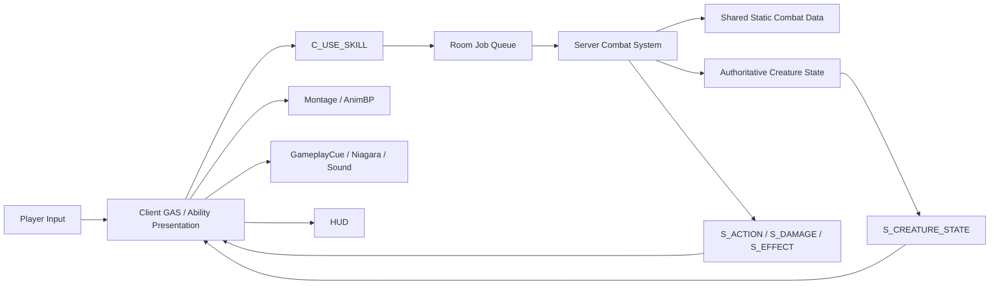
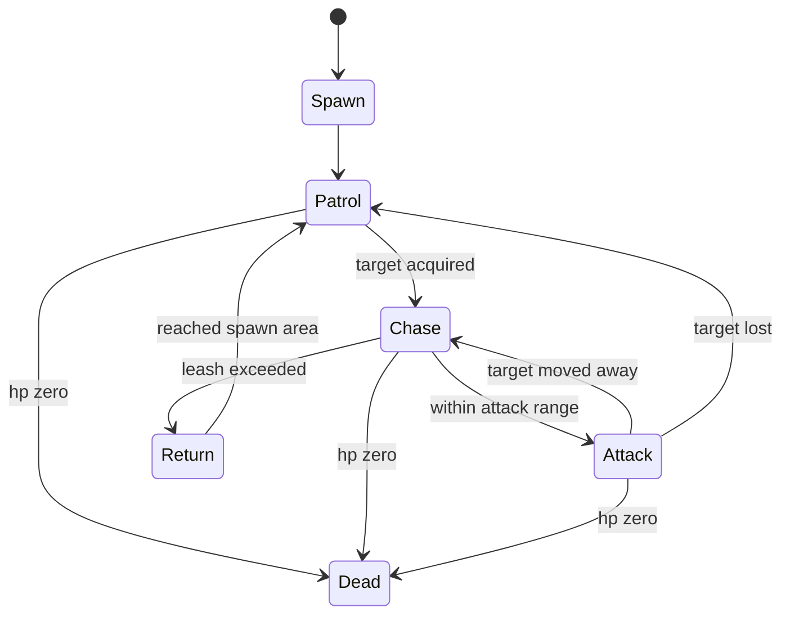

# S1 전투 콘텐츠 아키텍처 및 작업 계획

## 1. 목표와 범위

이 문서는 외부 C++ IOCP `GameServer`와 Unreal Engine 5 클라이언트 `S1`을 사용하는 간단한 멀티플레이 RPG 포트폴리오의 사전 설계다. 구현 목표는 다음 한 문장으로 제한한다.

> 3개 직업의 차별화된 전투, 서버 권위 몬스터 AI, 필드 이동과 채널 구조를 2~4명이 함께 확인할 수 있는 작은 RPG 전투 데모.

MVP 범위:

- 직업: 전사, 궁수, 마법사
- 직업별 기본 공격 1개와 대표 스킬 1개
- 일반 몬스터 1~2종
- A 필드와 B 필드
- 필드 이동, 전투, 사망/리스폰, 최소 HUD
- 서버 권위 판정과 다중 클라이언트 동기화

확장 범위:

- 직업별 보조 스킬 1개 추가
- 간단한 보스 1종
- A 필드 채널 1/2 또는 인스턴스 보스 룸
- 보상/드롭 최소 기능

퀘스트, 상점, 대규모 인벤토리, 장비 강화, 대화 시스템은 핵심 시연이 끝난 뒤에만 고려한다.

## 2. 가장 중요한 아키텍처 결정

### 2.1 서버가 전투의 유일한 권위자다

UE GAS는 원래 Unreal 서버/클라이언트 복제를 중심으로 설계되어 있지만, 이 프로젝트의 실제 서버는 Unreal Dedicated Server가 아닌 별도 IOCP 서버다. 따라서 GAS의 기본 Replication만으로 서버 권위를 만들 수 없다.

역할을 다음처럼 분리한다.

| 영역 | IOCP GameServer | UE5 클라이언트/GAS |
|---|---|---|
| 스킬 사용 가능 여부 | 최종 판정 | 입력 차단 및 로컬 사전 검사 |
| MP/쿨다운 | 원본 상태 | 서버 상태를 반영한 미러 |
| 명중/피해/치유/버프 | 최종 계산 | 예측 연출 및 결과 표현 |
| 몬스터 AI | 상태와 행동 결정 | 위치·애니메이션·연출 표현 |
| 투사체 충돌 | 최종 판정 | 시각 투사체 보간 |
| 애니메이션/VFX | 시작 이벤트와 결과 전파 | 실제 Montage, Niagara, Cue 실행 |

즉, GAS는 클라이언트의 **전투 표현·입력·상태 바인딩 계층**이고, GameServer의 Combat/Ability 로직이 **게임 규칙 계층**이다.

클라이언트가 `C_USE_SKILL`을 보낼 때 피해량을 보내지 않는다. 서버는 `AbilityId`, 시전자, 대상/방향, 서버 데이터로 모든 값을 다시 계산한다.

### 2.2 상태 스냅샷과 일회성 이벤트를 분리한다

- 상태: 위치, HP/MP, 활성 버프, 쿨다운 종료 시각, AI 상태
- 이벤트: 공격 시작, 투사체 생성, 명중, 치명타, 사망, Cue 실행

상태는 늦게 접속하거나 패킷 처리 순서가 달라도 현재 값을 복원할 수 있어야 한다. 이벤트는 `EventSequence`로 중복 실행을 방지한다.

### 2.3 게임 규칙 데이터와 UE 표현 데이터를 분리한다

- 공용 규칙 데이터: 수치, 사거리, 타이밍, 비용, 쿨다운, 판정 형태
- UE 표현 데이터: Montage, Niagara, Sound, Icon, Socket, Camera Shake

서버는 Unreal Asset 경로를 알 필요가 없다. 양쪽은 안정적인 문자열/정수 ID(`Ability.Knight.BasicAttack`)로 연결한다.

## 3. 전체 런타임 구조



서버 권장 계층:

- `Object`: ObjectId와 Room 소속
- `Creature`: 위치, 생존 상태, 공통 스탯, 효과 목록
- `Player`: 세션, CharacterId, PlayerClass, 입력 시퀀스
- `Monster`: MonsterDataId, AI 상태, SpawnPoint, AggroTable
- `Projectile`: 소유자, AbilityId, 위치/속도, 수명, 충돌 반경
- `Room`: 모든 객체 변경을 직렬화하는 JobQueue, Tick 및 Broadcast
- `CombatSystem`: 스킬 검증, 타깃 판정, 피해/치유/버프 적용
- `EffectSystem`: 지속시간 효과와 주기 효과 관리
- `AISystem`: 몬스터 FSM 업데이트
- `RoomManager`: Room 생성·조회·이동·정리

클라이언트 권장 계층:

- `AS1PlayerBase`: 공통 Mesh/이동/ASC 접근
- `AS1LocalPlayer`: 입력과 로컬 예측
- `AS1RemotePlayer`: 서버 이벤트 기반 표현
- `US1AbilitySystemComponent`: Ability ID/Tag 매핑, 서버 응답 적용
- `US1CombatAttributeSet`: Health, Mana, Attack, Defense 등 UI용 미러
- `US1WorldEntitySubsystem`: Player/Monster/Projectile Actor 생성·제거
- `US1CombatPresentationSubsystem`: 네트워크 전투 이벤트를 GAS/Cue/Animation으로 전달

## 4. Player와 GAS 설계

### 4.1 ASC 소유 위치

현재 `S1`은 Unreal의 네이티브 서버 복제를 사용하지 않고 외부 서버 상태로 Actor를 구성한다. MVP에서는 ASC와 AttributeSet을 `AS1PlayerBase`에 직접 두는 것이 단순하다.

`UE5_RPG`처럼 PlayerState가 ASC를 소유하면 Pawn 교체 후에도 상태가 유지되는 장점이 있지만, 현재 S1의 로그인/Room Actor 모델에는 Unreal PlayerState 복제의 실익이 작다. 캐릭터 교체나 부활 시 Pawn 교체가 필요해지는 시점에 PlayerState 소유로 확장한다.

### 4.2 AttributeSet

초기 공통 Attribute는 최소화한다.

- `Health`, `MaxHealth`
- `Mana`, `MaxMana`
- `AttackPower`
- `Defense`
- `MoveSpeed`
- `AttackSpeed`

피해나 치유 요청용 Meta Attribute를 사용할 경우 `IncomingDamage`, `IncomingHealing`을 추가한다. 단, 실제 계산은 서버 결과를 따른다. 클라이언트 AttributeSet은 서버가 보낸 결과값을 적용하고 UI Delegate를 제공한다.

### 4.3 Gameplay Tag 규칙

예시:

- `Ability.Knight.BasicAttack`, `Ability.Knight.GuardAura`
- `Ability.Archer.BasicShot`, `Ability.Archer.RapidFire`
- `Ability.Mage.FlameCone`, `Ability.Mage.Heal`
- `State.Attacking`, `State.Casting`, `State.Dead`, `State.Stunned`
- `Effect.Buff.Defense`, `Effect.Buff.RapidFire`, `Effect.Heal`
- `Cooldown.Knight.GuardAura` 등
- `Event.Combat.HitWindow`, `Event.Combat.ProjectileSpawn`
- `GameplayCue.Knight.Guard`, `GameplayCue.Archer.ArrowHit`, `GameplayCue.Mage.Flame`

입력 키가 아닌 게임 의미를 Tag 이름으로 사용한다.

### 4.4 Ability 실행 흐름

1. 로컬 플레이어가 Ability 입력
2. GAS가 Dead/Stun/로컬 쿨다운 등을 사전 확인
3. `ClientActionSequence`와 함께 `C_USE_SKILL` 전송
4. 허용된 예측 Ability는 Montage와 시작 Cue를 즉시 실행
5. 서버가 MP, 쿨다운, 상태, 사거리, 요청 속도를 검증
6. 성공 시 Room에 `ActionInstanceId`를 만들고 `S_ACTION_START` 전파
7. 서버 데이터의 HitTime/SpawnTime에 판정 실행
8. `S_DAMAGE`, `S_HEAL`, `S_EFFECT_APPLY`, `S_PROJECTILE_SPAWN` 전파
9. 클라이언트는 자신의 예측과 승인 이벤트를 매칭하고, 원격 캐릭터는 이벤트로 Montage 실행
10. 거절 시 `S_ACTION_REJECT`로 예측 Montage/Cue 및 로컬 예약 상태 취소

### 4.5 직업별 최소 스킬 구성

| 직업 | Ability | 서버 판정 | 클라이언트 표현 |
|---|---|---|---|
| 전사 | 기본 근접 공격 | 전방 Capsule/Box Sweep, 1회 피해 | Montage + 무기 Trail + Hit Cue |
| 전사 | 수호의 외침 | 반경 내 같은 파티/아군에게 Defense 버프 | 시전자/대상 Aura Cue |
| 궁수 | 기본 사격 | 서버 Projectile 생성 및 충돌 | Arrow Actor 보간 + Trail/Hit Cue |
| 궁수 | 속사 | 일정 시간 사격 간격 감소 또는 서버가 N회 사격 예약 | 속사 Montage/Loop + 연속 Projectile |
| 마법사 | 화염 방사 | 전방 Cone 판정, 짧은 다단 Hit 또는 1회 Hit | Cone Niagara + Hit Cue |
| 마법사 | 치유 | 대상 지정 또는 반경 내 아군 회복 | Cast Montage + Heal Cue |

포트폴리오 MVP에서는 각 직업 기본 공격과 대표 스킬 하나만 먼저 완성한다. 이후 전사의 버프, 궁수 속사, 마법사 힐을 두 번째 수직 슬라이스로 묶는다.

#### 전사

- 기본 공격: 서버 Action 시작 후 `HitTimeMs`에 시전자 Transform을 기준으로 Sweep
- 방어력 버프: `DurationMs`, `DefenseFlat` 또는 `DefensePct`를 서버 ActiveEffect로 저장
- 중복 정책: 동일 EffectId는 지속시간 갱신, 수치 중첩은 하지 않는 방식을 권장

#### 궁수

- 기본 사격: 서버가 Projectile ObjectId를 발급
- 속사: 클라이언트가 매 프레임 발사 요청을 보내지 않는다.
  - 간단한 방식: `RapidFire` 버프가 BasicShot의 서버 쿨다운을 감소
  - 연출이 정해진 방식: 서버가 ShotCount와 ShotInterval로 여러 발을 예약
- 요청 횟수와 서버 발사 간격을 함께 검증해 매크로/패킷 스팸을 막는다.

#### 마법사

- 화염: Cone의 각도·거리 안에 있는 대상을 서버가 필터링한다.
- 다단 히트는 `ActionInstanceId + HitIndex`로 중복 적용을 막는다.
- 힐: MVP에서는 대상 지정 대신 시전자 중심 작은 반경 AoE가 네트워크와 UX 모두 단순하다.

## 5. 애니메이션 동기화

이동 애니메이션은 현재처럼 서버 위치/속도를 보간하고 AnimBP가 속도로 Idle/Run을 결정한다. 전투 Montage는 이동 상태 값만으로 추론하지 않고 명시적 Action 이벤트로 시작한다.

`S_ACTION_START` 권장 필드:

- `action_instance_id`
- `actor_id`
- `ability_id`
- `action_sequence`
- `server_start_tick`
- `target_id` 또는 `aim_position/aim_yaw`
- `montage_variant`
- `play_rate`

동기화 원칙:

- 서버는 Montage Asset을 모르고 `AbilityId + Variant`만 보낸다.
- 원격 클라이언트는 이벤트 수신 즉시 해당 Montage를 재생한다.
- 늦게 수신한 경우 서버 시각 차이로 Montage 시작 위치를 보정할 수 있다.
- 실제 명중 시점은 AnimNotify가 서버에 알려주는 구조로 두지 않는다.
- 서버의 `HitTimeMs`가 권위 판정 시점이며 AnimNotify는 로컬 Trail, Sound, Gameplay Event 표현에 사용한다.
- 공격 취소, Stun, 사망은 `S_ACTION_CANCEL`로 Montage와 Loop Cue를 종료한다.

직업별 AnimBP는 하나의 공통 부모 AnimInstance와 직업별 Layer/Linked Anim Graph를 권장한다. Locomotion은 공유하고 무기 자세, 공격 Montage Slot, AimOffset만 직업별로 분리한다.

## 6. Projectile와 이펙트 동기화

### 6.1 Projectile

궁수 화살처럼 게임 판정에 영향을 주는 투사체는 서버 Object다.

1. 서버가 발사 시점에 시작 위치와 방향을 검증
2. `ProjectileId`, 위치, 속도, 생성 Tick, 수명을 기록
3. Room Tick에서 이동과 충돌을 판정
4. `S_PROJECTILE_SPAWN`으로 클라이언트가 시각 Actor 생성
5. 필요할 때만 저주기 보정 스냅샷 전송
6. 서버 명중 시 `S_PROJECTILE_HIT`과 `S_DAMAGE` 전송 후 제거

직선·무중력 화살은 동일 초기값과 서버 Tick으로 클라이언트가 거의 동일하게 계산할 수 있어 매 Tick 위치 패킷이 필요 없다. 유도탄이나 긴 수명의 느린 투사체만 보정 패킷을 사용한다.

### 6.2 Niagara/Particle/GameplayCue

파티클 개별 입자나 Niagara 시뮬레이션을 네트워크로 동기화하지 않는다. 다음 의미 이벤트만 전송한다.

- Cue ID
- Source/Target ObjectId
- 위치, 방향, Socket ID
- ActionInstanceId
- 필요한 수치 파라미터

즉시성 VFX는 각 클라이언트가 로컬로 Spawn한다. 지속형 버프 Aura는 상태 스냅샷의 ActiveEffect 목록을 통해 늦게 입장한 플레이어도 복구한다. 장판처럼 판정이 지속되는 효과는 서버에 AreaEffect Object를 두고, Niagara는 그 서버 객체의 시각 표현으로만 사용한다.

## 7. Monster 설계

### 7.1 서버 FSM

외부 GameServer가 권위자이므로 UE Behavior Tree를 그대로 실행할 수 없다. `UE5_RPG`의 FindTarget/CanAttack/Attack 구조를 서버 FSM으로 옮긴다.



요청한 흐름은 다음으로 구체화한다.

- 정찰(Patrol): SpawnPoint 주변 Waypoint 또는 랜덤 지점 이동
- 타겟 포착(Acquire): 감지 반경, 생존 여부, 같은 Room 여부 확인
- 접근(Chase): AttackRange까지 이동, LeashRange를 넘으면 복귀
- 공격(Attack): Cooldown과 거리 확인 후 Monster Ability 실행
- 복귀(Return): 타겟 해제, SpawnPoint로 이동, 필요하면 HP 초기화

타겟 선택은 MVP에서 가장 가까운 플레이어로 시작한다. 확장 시 `DamageAggro + HealAggro + DistanceWeight`의 AggroTable로 바꾼다.

### 7.2 서버 이동/길찾기 범위

IOCP 서버는 UE NavMesh를 직접 사용할 수 없다. 포트폴리오 규모에서는 다음 중 1단계를 권장한다.

1. 장애물이 적은 전투 필드 + 서버 Waypoint/직선 이동 + 단순 충돌
2. UE에서 Navigation Graph/Grid를 Export하고 서버가 A* 수행
3. 별도 Navigation 라이브러리 도입

MVP부터 완전한 NavMesh 동기화를 시도하면 전투보다 길찾기 프로젝트가 커진다. 맵을 서버 이동 모델에 맞춰 단순하게 설계한다.

### 7.3 Monster 데이터

- MonsterId, 이름/종류
- MaxHP, Attack, Defense, MoveSpeed
- SightRange, LoseTargetRange, AttackRange, LeashRange
- AttackAbilityId, AttackCooldown
- RespawnTime, SpawnGroupId
- UE 전용: Mesh, AnimBP, Montage, Hit/Death Cue

몬스터의 런타임 HP나 Aggro는 Room 메모리에만 둔다. 일반 몬스터 상태를 SQL에 저장하지 않는다.

## 8. Boss 제안

Boss는 일반 Monster FSM과 Ability 실행 구조가 안정된 뒤 추가한다. 별도의 완전히 다른 시스템 대신 `BossController/PatternSelector`만 확장한다.

포트폴리오에 적당한 1보스 구성:

- Phase 1: 근접 휘두르기, 전방 Cone 장판
- Phase 2(HP 50%): 공격 속도 상승 + 원형 AoE
- 선택 기능: 특정 플레이어 대상 돌진

Pattern 데이터:

- PatternId, 사용 거리, 가중치, 쿨다운
- 최소/최대 HP 구간
- CastTime, TelegraphTime, HitTimes
- 판정 Shape와 수치
- 다음 패턴 제한 Tag

중요한 시연 요소는 패턴 수가 아니라 **서버가 패턴 선택·예고·판정하고 모든 클라이언트가 같은 결과를 보는 것**이다. 보스 사망 시 보스 HP UI, Gate Open, 결과 UI 정도만 가져오고 긴 시네마틱은 후순위로 둔다.

## 9. 데이터 관리

### 9.1 SQL에 저장할 동적 데이터

- Account, Character 기본 식별 정보
- 직업, 레벨, 경험치
- 현재 필드/안전한 저장 위치
- 소유 아이템/장비/골드(기능을 넣는 경우)
- 해금 상태와 보스 클리어 여부(기능을 넣는 경우)

HP, MP, 공격력 같은 파생 수치를 매번 SQL에 중복 저장하지 않는다. 기본 수치와 레벨/장비 데이터로 계산한다. 로그아웃 시 현재 HP 저장 여부는 기획 정책으로만 결정한다.

### 9.2 정적 게임 데이터

권장 파이프라인:

1. 기획 작성은 CSV(평면 테이블)와 JSON(중첩 타임라인/패턴)
2. 빌드 전 Validation Tool이 ID 중복, 참조 누락, 음수 값, 타이밍 오류 검사
3. 서버는 검증된 JSON 또는 생성된 C++ 데이터 로드
4. UE는 동일 ID의 DataTable/DataAsset를 로드
5. 서버와 클라이언트가 `CombatDataVersion/Hash`를 로그인 또는 입장 시 비교

분리 예:

- `PlayerClass.csv`: 직업 기본 스탯
- `Monster.csv`: 몬스터 기본 스탯과 AI 범위
- `Ability.json`: 비용, 쿨다운, 타임라인, 판정 Shape
- `Effect.json`: 버프/디버프 수치와 중첩 정책
- `MapRoom.json`: 필드, SpawnPoint, Portal, 채널 설정
- UE DataAsset: Montage/Niagara/Sound/Icon 매핑

CSV와 JSON 중 하나만 고르면 서버 파싱과 리뷰가 쉬운 JSON을 권장한다. 다만 밸런스 수치의 대량 편집은 CSV가 편하므로, **CSV/JSON을 작성 포맷으로 사용하고 하나의 검증/변환 단계로 서버 데이터를 생성**하는 것이 가장 안전하다.

## 10. Room과 필드/채널

### 10.1 Room 식별자

현재 단일 `GRoom`을 다음 구조로 확장한다.

```text
RoomKey = { ZoneId, ChannelId, InstanceId }
```

- `ZoneId`: AField, BField, BossField
- `ChannelId`: 공개 필드의 1/2/3 채널
- `InstanceId`: 파티 던전/보스 인스턴스, 공개 필드는 0

`RoomManager` 책임:

- Room 생성/조회/제거
- 채널별 인원 집계
- 입장 가능한 채널 선택
- RoomId/ObjectId 발급 또는 연결
- Room 변경 조정

Room 책임:

- 자기 객체 목록
- JobQueue 기반 직렬 처리
- Tick, AI, Combat, Spawn/Despawn
- 자기 Room 내부 Broadcast

### 10.2 A 필드 1/2/3 채널을 구현할 것인가

구조는 처음부터 N개 채널을 지원하도록 만드는 것이 좋다. 그러나 포트폴리오 시연을 위해 실제로 3개 채널을 항상 띄울 필요는 없다.

권장 범위:

- MVP: AField-1, BField-1
- 확장 시연: AField-2를 동적으로 생성해 채널 선택/분리 증명
- 3채널은 설정값만 지원

채널의 목적은 같은 맵의 부하 분산이다. 플레이어가 적은 데모에서 3채널은 콘텐츠를 비어 보이게 하므로 기본 자동 배치는 인원이 있는 채널을 우선한다.

### 10.3 A 필드에서 B 필드로 이동

Portal을 사용한 2단계 전환을 권장한다.

1. 클라이언트 `C_REQUEST_ROOM_TRANSFER(portal_id)`
2. Source Room이 전투 중 여부, 위치, Portal 접근 가능 여부 검증
3. RoomManager가 Destination Room과 SpawnPoint 예약
4. Source Room에서 객체 제거 및 주변에 Despawn
5. 서버가 `S_PREPARE_ROOM_TRANSFER` 전송
6. 클라이언트가 B 필드 레벨 로드
7. 클라이언트 `C_ROOM_READY(transfer_token)`
8. Destination Room에 객체 추가
9. 서버가 Self Snapshot + 주변 Spawn Snapshot 전송

두 Room의 Lock을 동시에 잡지 않는다. RoomManager의 TransferContext와 각 Room JobQueue 메시지를 통해 순차 처리한다. 실패/연결 종료 시 Source 복귀 또는 안전 Spawn으로 복구한다.

같은 맵의 채널 이동도 같은 프로토콜을 사용하되 UE 레벨 재로드만 생략할 수 있다.

## 11. 권장 패킷 그룹

정확한 Proto는 구현 단계에서 확정하되 책임은 미리 나눈다.

- 입장: `C_ENTER_ROOM`, `S_ROOM_SNAPSHOT`, `S_SPAWN`, `S_DESPAWN`
- 이동: `C_MOVE_INPUT/STATE`, `S_MOVE`, `S_POSITION_CORRECTION`
- 전투 명령: `C_USE_SKILL`, `C_CANCEL_SKILL`
- 전투 이벤트: `S_ACTION_START`, `S_ACTION_REJECT`, `S_ACTION_CANCEL`
- 결과: `S_DAMAGE`, `S_HEAL`, `S_EFFECT_APPLY/REMOVE`, `S_DEAD`, `S_RESPAWN`
- 투사체: `S_PROJECTILE_SPAWN`, `S_PROJECTILE_CORRECT`, `S_PROJECTILE_HIT/DESPAWN`
- 몬스터: `S_AI_STATE`는 디버그/표현에 필요한 최소 상태만
- 필드 변경: `C_REQUEST_ROOM_TRANSFER`, `S_PREPARE_ROOM_TRANSFER`, `C_ROOM_READY`

TCP를 사용하므로 전투 이벤트는 전달되지만 지연된 오래된 이동 패킷이 앞을 막는 Head-of-Line 현상은 남는다. 포트폴리오 MVP는 현 구조로 진행하고, 측정 결과가 필요할 때만 이동 채널 분리/UDP를 확장 주제로 제시한다.

## 12. UE5_RPG에서 가져올 가치가 높은 요소

우선 적용:

- Gameplay Tag 체계와 Ability ID 중심 활성화
- AnimNotify에서 Gameplay Event/Cue를 발생시키는 표현 구조
- 공통 AttributeSet + Player/Monster 확장 Set
- DataTable/Settings/Subsystem을 통한 데이터 접근
- FindTarget → CanAttack → GAS Attack의 AI 분리 개념
- Monster HP Bar, Boss HP Bar, Damage Text
- Projectile Base와 Hit/Trail 표현 분리
- Cooldown QuickSlot 표시
- 몬스터 Death Dissolve

선별 적용:

- Boss 가중치/거리/쿨다운 기반 Pattern 선택
- Monster Drop Table과 서버 Seed 기반 보상
- Boss Field Gate/결과 UI
- Minimap 아이콘

후순위 또는 제외:

- 퀘스트, 대화, 상점, 완전한 인벤토리/장비
- 복잡한 카메라/시네마틱
- 다수 보스 패턴과 긴 콤보 체계
- 싱글플레이 전제의 직접 `OnDamaged`/로컬 Collision 판정

## 13. 작업 우선순위

### Phase 0 — 계약과 진단 기반

1. 서버 권위 원칙 및 Ability/Effect/Action ID 규칙 확정
2. 공용 데이터 Schema와 Version/Hash 정의
3. Room Tick, 패킷 RTT, ActionInstanceId 로그 추가 계획

상세 계약: [서버 권위 원칙과 Combat ID 계약](AuthorityAndCombatIdContract.md)

완료 기준: 종이에 BasicAttack 요청부터 Damage 결과까지의 패킷 흐름이 끊김 없이 설명된다.

### Phase 1 — 전사 수직 슬라이스

1. 서버 Creature Stats/CombatSystem 기초
2. 클라이언트 ASC/AttributeSet/Tag 기초
3. 전사 기본 근접 공격
4. 서버 명중/피해/사망과 클라이언트 Montage/Cue/HUD
5. 두 클라이언트에서 같은 결과 확인

완료 기준: 공격자·관전자 모두 같은 타이밍의 공격과 HP/사망 결과를 본다.

### Phase 2 — Monster 수직 슬라이스

1. Monster Spawn/Despawn
2. Patrol/Acquire/Chase/Attack/Return FSM
3. Monster 근접 공격과 플레이어 피해
4. 사망/Respawn, HP Bar, Death Cue

완료 기준: 몬스터가 서버 Tick만으로 두 플레이어 중 대상을 선택하고 전투한다.

### Phase 3 — 세 직업 차별화

1. 궁수 Projectile 기본 사격
2. 마법사 Cone 화염
3. 전사 방어 버프
4. 궁수 속사
5. 마법사 AoE Heal

완료 기준: 근접/Projectile/Cone/버프/힐의 서로 다른 서버 판정 방식을 보여준다.

### Phase 4 — Room/필드

1. `GRoom`을 `RoomManager + RoomKey`로 전환
2. AField-1/BField-1 생성
3. Portal 기반 Transfer handshake
4. AField-2 동적 채널 생성과 채널 선택

완료 기준: 같은 필드 다른 채널은 서로 보이지 않고, 필드 이동 후 정확한 Snapshot이 복구된다.

### Phase 5 — 포트폴리오 완성도

1. Cooldown/Buff/HUD와 Damage Text
2. 데이터 Validation Tool과 서버-클라이언트 Hash 검사
3. 패킷 로그/Room 디버그 뷰
4. 지연 환경에서 예측/보정 시연
5. README 아키텍처 다이어그램과 데모 영상

### Phase 6 — 선택적 Boss

1. Pattern Selector
2. Cone Telegraph와 원형 AoE
3. HP 50% Phase 전환
4. Boss HP UI와 Gate/Result

Boss는 Phase 1~5가 안정된 경우에만 추가한다.

## 14. MVP 완료 정의

- 두 개 이상의 클라이언트가 동일 Room에 입장 가능
- 3개 직업 모두 기본 공격과 대표 스킬을 사용 가능
- 모든 피해, 치유, 버프, 쿨다운은 서버가 검증
- 궁수 Projectile의 명중은 서버가 결정
- Monster AI가 서버에서 Patrol부터 Attack까지 수행
- A 필드와 B 필드 간 이동 가능
- 최소 HUD로 HP/MP/쿨다운/버프를 확인 가능
- 잘못된 스킬 연타, 거리 위조, ObjectId 위조를 서버가 거절
- 설계 다이어그램, 패킷 흐름, 데이터 Schema, 테스트 영상이 저장됨

이 기준을 충족하면 Boss나 복잡한 생활 콘텐츠가 없어도 IOCP, 동시성, 데이터 주도 설계, GAS 표현 계층, 서버 권위 전투를 한 프로젝트에서 충분히 보여줄 수 있다.
